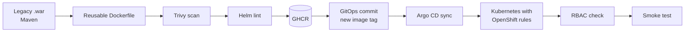

# Legacy services modernised onto OpenShift

A legacy Java web app (a `.war` on Tomcat) taken from "copy it to a server by hand" to a standard, scanned container image,
deployed through Git by Argo CD onto Kubernetes with **OpenShift's security rules switched on**.

[Live pipeline →](https://danielkojomegbenu.com/projects/openshift-modernisation)

## The pipeline



| Step | What happens | Fails the run when |
|---|---|---|
| 1. Build WAR | `mvn verify` compiles the servlet, runs the unit tests and packages `inventory.war` | A test fails |
| 2. Reusable Dockerfile | `docker/tomcat-war.Dockerfile` turns **any** `.war` into an image (`--build-arg WAR_FILE=...`) | The build fails |
| 3. Image scan | Trivy checks the image for fixable HIGH and CRITICAL vulnerabilities | Any are found |
| 4. Helm lint | Lints and renders the chart | The chart is invalid |
| 5. Registry | Pushes the image to GHCR, tagged with the commit SHA (main only) | |
| 6. GitOps commit | CI writes the new tag into `gitops/values-kind.yaml` and commits it. **Git is the only way to deploy** | |
| 7. Argo CD sync | A fresh cluster with Argo CD pulls that commit and syncs the Helm chart until it's Synced and Healthy | Pods don't become healthy |
| 8. OpenShift rules | Checks the namespace enforces `restricted`, the app runs as a random UID, and its root filesystem is read-only | Any rule isn't met |
| 9. RBAC check | Developers can view pods and logs, but can't change anything or read secrets | Any permission is wrong |
| 10. Smoke test | Calls the app through its Service | The stock list is wrong |

Pull requests run steps 1 to 4, so a vulnerable or broken image never reaches the registry.

## What "the OpenShift way" means here

OpenShift is stricter than plain Kubernetes by default. This app is built to pass those rules, so it runs on either:

| OpenShift rule | How the app meets it |
|---|---|
| Pods run as a **random UID** from the namespace's range | The image gives group 0 ownership of the only writable directories, so any UID works. CI proves it by running as `1000680000` |
| `restricted` security: no root, no privilege escalation, no capabilities | `runAsNonRoot`, `allowPrivilegeEscalation: false`, `drop: [ALL]`, `seccompProfile: RuntimeDefault` |
| Read-only root filesystem is expected | The `.war` is unpacked at build time. Only Tomcat's logs, temp and work directories are writable (`emptyDir`) |
| Apps are exposed with a **Route** | The chart has an optional `route.yaml`. Set `route.enabled=true` on OpenShift |

In CI, a [kind](https://kind.sigs.k8s.io/) cluster enforces the same rules with Kubernetes Pod Security Admission (`restricted`).

## Image hygiene

- One reusable Dockerfile for every `.war`, instead of a different hand-written one per app.
- Tomcat's default apps (manager, examples) are removed. They're a common audit finding.
- OS packages are upgraded at build time, and Trivy blocks anything fixable that's HIGH or worse.
- Images are tagged with the commit SHA, so every deployment traces back to the exact commit.

## See a scan block an old image

Open the pull request **demo/old-base-image**. It moves the Dockerfile back to a 2023 Tomcat. The app still builds and its tests pass, but the **Image scan** finds known vulnerabilities and stops the run before the image is stored.

## Run it on your machine

```bash
cd app && mvn verify && cd ..
docker build -f docker/tomcat-war.Dockerfile --build-arg WAR_FILE=app/target/inventory.war -t inventory .
docker run --rm -p 8080:8080 --user 1000680000:0 --read-only \
  --tmpfs /usr/local/tomcat/logs --tmpfs /usr/local/tomcat/temp --tmpfs /usr/local/tomcat/work inventory
curl localhost:8080/inventory/items
```

## What's in the repo

| Path | What it is |
|---|---|
| `app/` | The legacy inventory servlet, its tests and `pom.xml` |
| `docker/tomcat-war.Dockerfile` | The reusable, OpenShift-ready Dockerfile |
| `chart/inventory/` | Helm chart: Deployment, Service, optional Route, RBAC |
| `gitops/` | The desired state (`values-kind.yaml`) and the Argo CD Application |
| `.github/workflows/modernise.yml` | The pipeline |

## Cost

Free. GitHub Actions and GHCR are free for public repos, and the cluster only exists while the pipeline runs.
